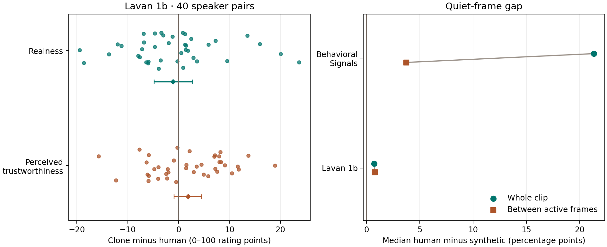

# Bodh (बोध)

Bodh is a local research toolkit for audio authenticity, factual claim review, and human perception. It studies how a recording was produced, how listeners perceive it, and where those judgments diverge.

## What Bodh does

- **Audio authenticity.** Extract features, audit dataset splits, and evaluate lightweight detectors and a spectrogram Transformer trained from scratch. Compare performance across datasets and under controlled background noise.
- **Spoken claim review.** Transcribe local audio with `whisper.cpp`, retrieve candidate evidence from AVeriTeC, and show the published verdict for a unique exact claim match. Unfamiliar claims are marked `needs_review`. [Media review guide](docs/media-review.md)
- **Audience response.** Compare how observed listener groups rated the same voice pair. Run a local product study that presents one of two versions, records an anonymous answer, and evaluates audience forecasts against a fresh group of participants. [Product audience guide](docs/product-audience.md)

## What the experiments found

- **Recording differences can look like detection signal.** In a 22-clip speech pilot, the median quiet-frame gap between genuine and spoofed clips fell from 21.3 to 3.7 percentage points after excluding quiet frames at the clip edges.
- **Official speaker IDs can miss overlap.** The ASVspoof source map exposed 10 shared underlying speakers and three reused source recordings in the sampled train and development partitions. The stricter split recorded and excluded the overlapping clips.
- **The lightweight baseline held up best.** On 200 audited ASVspoof evaluation clips after quiet-edge trimming, simple cues reached **0.763 ROC-AUC**, compared with **0.727** for a randomly initialized Transformer and **0.714** for the pretrained Transformer. The pretrained embeddings also did not improve on the training-mean predictor for held-out Lavan rating groups.
- **Transfer gains were sensitive to noise.** On the previously examined In-the-Wild pilot, an ASVspoof-trained temporal spectral model increased ROC-AUC from **0.475 to 0.655**. Adding pink noise at 10 dB SNR reduced it to **0.538**.
- **Listeners differed in how real clones sounded.** On 20 held-out speaker pairs, one calibrated listener group rated the clones **4.78 points higher** than human recordings, while the other rated them **3.64 points lower**, on a 0–100 scale. These rankings describe the listeners in that study.



See the [research notes](docs/research.md) for datasets and pilot findings, the [evaluation report](docs/evaluation.md) for the model comparisons, and the [media review guide](docs/media-review.md) for the independent audio benchmark and claim-evidence demo.

## Quickstart

Use Python 3.12 with FFmpeg and FFprobe on your PATH. On macOS, FFmpeg can be installed with Homebrew. On Ubuntu, it is available as the `ffmpeg` package.

```sh
python3.12 -m venv .venv
source .venv/bin/activate
python -m pip install .
python scripts/signal_fixture.py data/tones
bodh eda data/tones/manifest.csv data/tones runs/tones
```

The example generates eight test tones locally and produces clip features, a JSON summary, and plots in `runs/tones/`. It runs offline after installation and uses no dataset download. Choose fresh output directories when rerunning a command.

## Repository guide

| Path | Purpose |
| --- | --- |
| [`src/bodh/`](src/bodh/) | CLI, audio processing, manifests, listener statistics, baselines, and the Transformer |
| [`scripts/`](scripts/) | Dataset acquisition, split audits, experiment runners, and generated test audio |
| [`examples/`](examples/) | A local study comparing two ways of communicating claim-review status |
| [`tests/`](tests/) | Tests that run on generated audio and synthetic rating records |
| [`docs/`](docs/) | Study design, aggregate results, and reproduction commands |

The [reproduction guide](docs/reproduction.md) covers the public datasets and full experiment sequence. Transformer pretraining and transfer use the optional `pretrain` extra. Run the local tests with `python -m unittest discover -s tests -v`.

## Data and scope

Raw audio, speaker and listener records, local results, and model checkpoints stay in ignored directories. The repository contains code, methods, and aggregate findings. Source datasets have their own terms and should be acquired from their publishers.

A dataset's authenticity label describes how a recording was produced. Listener ratings describe judgments in a particular study. Truthfulness requires independent evidence. Cross-corpus results describe the evaluated samples. The audience forecasting workflow was backtested on existing listener data, and the example product study awaits responses from real participants.
